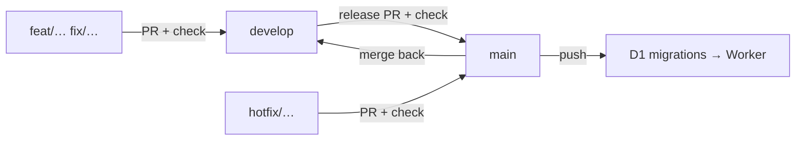

# Branches, CI and deploys

`main` is production. `develop` is where work meets before production. GitHub
Actions checks every pull request and deploys `main`.



## Branches

| Branch | Role | Rules |
| --- | --- | --- |
| `main` | Production. Every push migrates and deploys. | Only receives merges from `develop` or a `hotfix/*` branch. |
| `develop` | Integration. Accumulates finished work. | Receives feature branches through a PR with a green `check`. |
| `feat/<topic>`, `fix/<topic>` | One change. | Branch from `develop`, PR back into `develop`. |
| `hotfix/<topic>` | Urgent production fix. | Branch from `main`, PR into `main`, then merge `main` back into `develop`. |

Merge style: **squash** into `develop` (one commit per feature). Release PRs
`develop` → `main` use a **merge commit**, so `develop` stays an ancestor of
`main` and the next release does not replay old commits.

## CI — `.github/workflows/ci.yml`

| Event | `check` | `deploy-production` |
| --- | --- | --- |
| Pull request | yes | no |
| Push to `develop` | yes | no |
| Push to `main` | yes | yes, after `check` |
| Manual (`workflow_dispatch`) | yes | only when run on `main` |

`check` runs the focused-test guard (`test.only` etc.), `pnpm check-types`,
`pnpm test` and `pnpm build`.

`deploy-production` rebuilds and runs `pnpm run deploy`, which is
`wrangler d1 migrations apply DB --remote` followed by `wrangler deploy`, in the
`production` environment. It is serialised by its own concurrency group: two
merges never deploy at the same time and a running deploy is never cancelled.

> **A merge to `main` applies the pending D1 migrations to the production
> database.** That is what the documented deploy path does; keep migrations
> backward compatible with the previous Worker version so a rollback stays
> possible. While the Cloudflare credentials are missing, the job skips the
> deploy with a warning annotation instead of failing `main`.

## One-time setup

Create these repository secrets in **Settings → Secrets and variables → Actions**:

| Secret | Value |
| --- | --- |
| `CLOUDFLARE_API_TOKEN` | API token with **Workers Scripts: Edit** and **D1: Edit** for the account. |
| `CLOUDFLARE_ACCOUNT_ID` | Account ID from the Cloudflare dashboard. |

The Worker secrets (`BETTER_AUTH_SECRET`, the email provider variables) are
**not** part of the workflow: they live in the Worker and `wrangler deploy`
leaves existing secrets untouched.

## Rolling back

```bash
pnpm exec wrangler deployments list
pnpm exec wrangler rollback <deployment-id>
```

A rollback reverts the Worker, not the database. Land the revert on `main`
afterwards so the next deploy does not re-ship the broken version.

## Why there is no branch protection yet

GitHub rulesets and branch protection require GitHub Pro for **private**
repositories; this repository is private, so the API answers
`403 Upgrade to GitHub Pro`. The flow is held by CI and convention until the
account upgrades or the repository becomes public. Once available, protect
`main` with a required pull request and the `check` status check.
